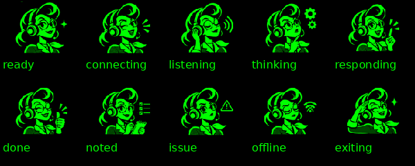
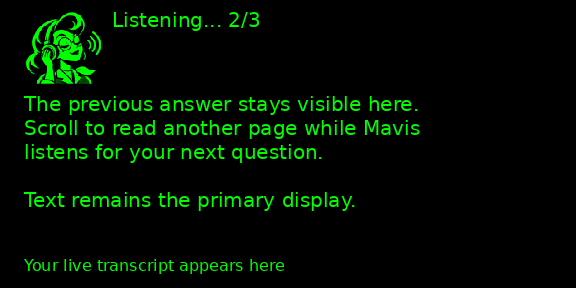

# Mavis on G2

Mavis uses the ten approved PNG masters from Issue #26. `public/mavis/` preserves their exact bytes and SHA-256 manifest, and Vite copies them into the package. `src/assets/mavis/` contains presentation copies resized to 80×80 with Pillow's nearest-neighbor resampling, retaining the indexed palette and saving at 4 bits. `blank.png` is an all-zero 80×80 image for settings. No artwork is generated or downloaded at runtime; the presentation PNGs are inlined in the JavaScript bundle.

The installed `@evenrealities/even_hub_sdk` is **0.0.10**. Its README examples and declarations specify `imageObject`, `ImageContainerProperty`, and `updateImageRawData(new ImageRawDataUpdate({ containerID, containerName, imageData }))`. We supply encoded local PNG bytes as `number[]`; the host handles image decoding/grayscale conversion. We check the SDK's `ImageRawDataUpdateResult.success`, which is not proof of physical delivery. The [WebView display reference](https://hub.evenrealities.com/docs/build/display) confirms the 576×288 canvas, image limits and serialized image transfers. Newer features on that page (z-order, text brightness, compression/pacing) are not used. No enterprise API or SDK upgrade is involved.

| Region | Position | Size |
| --- | --- | --- |
| Mavis | 24, 8 | 80×80 |
| Status/title | 112, 8 | 440×80 |
| Answer/transcript | 24, 92 | 528×156 |
| Controls/live transcript | 24, 256 | 528×32 |

The previous layout extended to x=584 and y=318. The new regions fit the documented canvas without overlap; only the header reserves avatar space. The body and footer span the available width. The body remains the sole event-capture container. Text formatting, page slicing and gestures are unchanged; this does not address #23. The shorter body can require native scrolling, so physical readability remains an owner check.

Screen state determines the image. Home and stopping use ready; connecting, confirmed listening and thinking use their respective images. Terminal pages use done, except missing/degraded/failed responses use issue. Errors use issue. Settings clear the image. Current connecting/listening/thinking status takes priority over an old answer. The controller does not expose an independent known-disconnect, streaming, acknowledgement or exit state, so offline, responding, noted and exiting remain bundled but unused. Error strings and answer wording never select a pose.

Images have a separate path with one in-flight write and one replaceable pending state. Unchanged poses do not resend. Text, capture, stop, scrolling and turn completion never await an image. Failure or a 1.5-second image timeout disables further image writes for that display instance and attempts a text-only rebuild. No second image is sent after a timeout, even if the original native call later completes. Late rebuild completion refreshes the latest text. A host that also rejects the rebuild may retain an old bitmap; the explicit status text remains authoritative. There is no claim that a failed native bridge can guarantee clearing physical pixels. Missing image/rebuild APIs use text-only startup; a rejected image layout recovers through `rebuildPageContainer` with the three text containers. Startup is called only once. Recovery must acknowledge `true` before a usable display is returned; failed, rejected or timed-out recovery leaves conversation readiness disabled.

## Visual evidence and limitations

These are static previews inspected at native pixel size, **not simulator or hardware screenshots**. Round glasses, headset, scarf, hair and pose differences remain recognizable at 80px, and the layout preview leaves the text unobstructed. Preview labels are outside the sprite files. Text uses a substitute desktop font; firmware wrapping and clarity are not verified by this image.

The installed simulator 0.7.3 cannot start in this environment: `libwebkit2gtk-4.1.so.0` is missing. Its README also says image limits and timing are not hardware-faithful. Native PNG decoding, G2 clarity, transfer latency, scrolling, input and microphone regressions remain pending owner testing of the independently reviewed candidate. Use the README's candidate-build procedure; no merge, tag or deployment is needed for that test.

For ordinary owner use: check initial ready, connecting before mic acknowledgement, listening with live transcript, thinking, a completed answer and rearm while it remains visible. Scroll the old answer and stop during each active phase. Check errors and settings, and verify text still works when the image path fails. Keep #24/#25's independent exit work separate.

Automated coverage includes exact master hashes, PNG dimensions and inlined bytes, SDK serialization, actual state mapping, degraded/error states, previous-answer rearm, bounds and nonoverlap, body event capture, missing/failed image support, deduplication, delayed/stale writes, timeout, text-only fallback, delayed rebuild restoration and settings clearing. Existing conversation and input lifecycle tests run unchanged.
